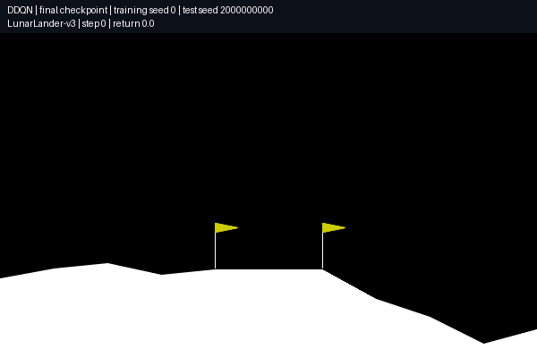
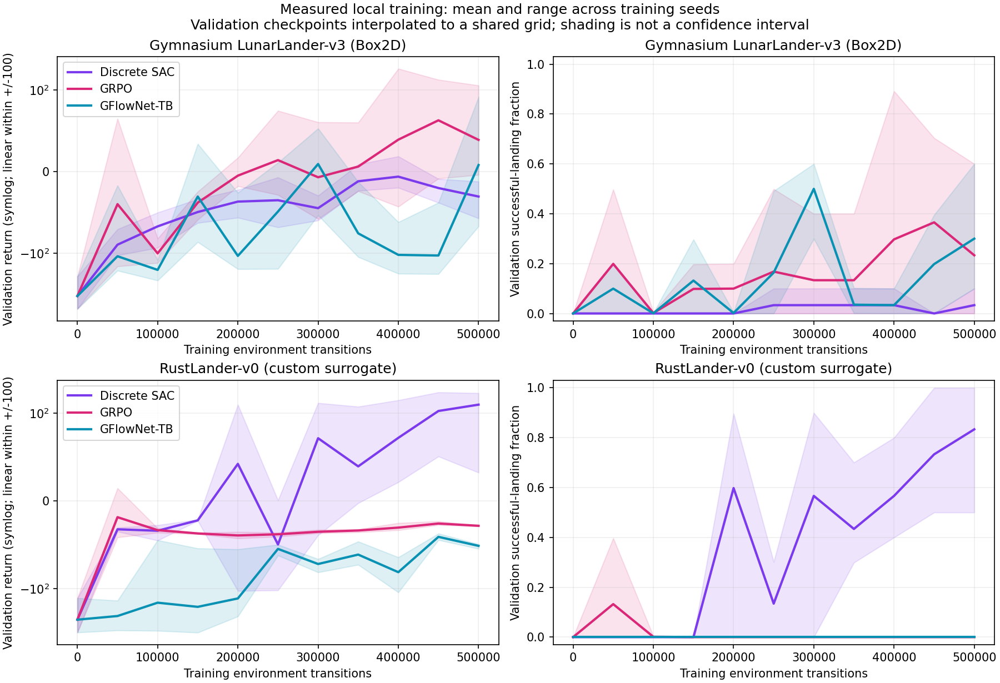

# lunar_bench: six RL algorithms on LunarLander, from scratch in NumPy

Six reinforcement-learning algorithms, written from scratch in NumPy, are trained under one fixed budget: 500k environment
steps, 3 training seeds, 100 held-out test episodes per seed, CPU only. The six are PPO, A2C, Double DQN, Discrete SAC,
GRPO and GFlowNet-TB. Training runs on Gymnasium **LunarLander-v3 (Box2D)** and on **RustLander-v0**, a simplified
landing simulator written in Rust with a batched C ABI.

| Double DQN: lands (+229, 302 steps) | PPO: hovers until the time limit (−44) | A2C: crashes (−3,946) |
|---|---|---|
|  |  |  |
| **GRPO: hovers (−42)** | **GFlowNet-TB: hovers (−61)** | **Discrete SAC: hovers (−63)** |
|  |  |  |

*All six panels use the same held-out test episode (environment seed 2000000000), the seed-0 final checkpoints and
greedy actions. Each GIF is a replay that was checked to match the recorded test episode step for step. A single episode
is an illustration only; the tables below average 300 episodes per method.*

## Results at a glance: Gymnasium LunarLander-v3 (greedy policy, final 500k-step checkpoint)

| method | mean test return ± SD over 3 seeds | per-seed range | successful landings (per-seed range) | training time per seed |
|---|---|---|---|---|
| **Double DQN** | **184 ± 67** | 122 to 255 | **70 %** (52–96 %) | 201 s |
| GRPO | 49 ± 92 | −5 to 155 | 23 % (0–66 %) | 63 s |
| GFlowNet-TB | −16 ± 94 | −104 to 82 | 21 % (1–48 %) | 626 s |
| Discrete SAC | −40 ± 28 | −72 to −23 | 0.3 % (0–1 %) | 393 s |
| PPO | −105 ± 72 | −152 to −23 | 0 % | 61 s |
| A2C | −2,666 ± 1,115 | −3,908 to −1,750 | 0 % | 53 s |
| hand-written heuristic controller | 235 | – | 92 % | – |
| random actions | −190 | – | 0 % | – |

**Secondary evaluation with sampled actions.** The same checkpoints were run again with actions sampled from the
policy instead of the argmax:

| method | mean return | landings |
|---|---|---|
| PPO | 24 ± 140 | 43 % (seed 0: 174 and 80 %) |
| GRPO | 35 | 0 % |
| Discrete SAC | −29 | 4 % |
| GFlowNet-TB | −45 | 0 % |
| A2C | −45 | 0 % |

| PPO, A2C, Double DQN | Discrete SAC, GRPO, GFlowNet-TB |
|---|---|
|  |  |

### Key findings
* **Double DQN is the best learner on the Box2D task within 500k steps:** 70 % landings, ranging from 52 % to 96 %
  across seeds.
* **The critic-free GRPO comes second (49), but depends on the seed.** One seed lands 66 % of its episodes; the other
  two almost never land.
* **GFlowNet-TB lands 21 % of the time even though it is not a return maximiser.** It learns to sample trajectories in
  proportion to a transformed reward, so its greedy policy is a by-product of that sampler.
* **Greedy and sampled execution can disagree sharply.** On RustLander, the GRPO and GFlowNet greedy policies never
  land, yet sampling from the same policies lands 92 % and 90 % of episodes. PPO shows the same on Box2D. Both
  evaluation modes are reported, kept separate.
* **Discrete SAC is slow on Box2D (−40) but is the best greedy policy on RustLander (131, 83 % landings).**
* **A2C diverges with these settings**: its validation return keeps falling. This is a result for one configuration,
  not a verdict on A2C.
* **The batched Rust simulator delivers about 100× more transitions per second** than stepping Box2D from Python.
  RustLander is a simplified point-body model, so its scores are not comparable to LunarLander
  ([RUST_MODEL.txt](RUST_MODEL.txt)).
* **Limitations:**
  * Only 3 training seeds, so the ranges are full spreads, not confidence intervals.
  * One fixed hyperparameter setting per method, chosen in advance and not tuned.
  * CPU only, on one Windows laptop.

## RustLander-v0 (simplified simulator, same protocol)

| method | greedy return ± SD | greedy landings | sampled return | sampled landings |
|---|---|---|---|---|
| Discrete SAC | **131 ± 48** | **83 %** | 127 | 82 % |
| Double DQN | 105 ± 61 | 63 % | – | – |
| PPO | −28 ± 52 | 21 % | 49 | 47 % |
| GRPO | −29 ± 0.4 | 0 % | **168** | **92 %** |
| GFlowNet-TB | −53 ± 2 | 0 % | 63 | 90 % |
| A2C | −264 ± 7 | 0 % | −171 | 0.3 % |
| heuristic / random | 191 / −153 | 100 % / 0 % | | |

## Simulator throughput (isolated runs after training, steps per second)

| mode | steps/s | notes |
|---|---|---|
| Gymnasium Box2D, one env stepped from Python | 6,455 ± 1,415 | 5 repeats × 100k steps |
| RustLander, one env stepped from Python (FFI per step) | 8,722 ± 1,720 | 5 repeats |
| RustLander, batch of 128 envs per FFI call | 691,408 ± 172,879 | 5 repeats |
| RustLander, pure Rust loop (no FFI) | ≈ 16.9 M | 3 repeats, separate run |

Running six independent single-thread training processes in parallel was **4.7× faster** than running them one after
another (153 s → 32 s for 6 runs of 32,768 steps; a single matched timing pair).

## Protocol
* **Environment:** unmodified Gymnasium 1.2.3 LunarLander-v3 with Box2D 2.3.10, discrete actions, default gravity,
  no wind and a 1,000-step time limit.
* **Budget and seeds:** 500,000 transitions per method, environment and training seed (seeds 0, 1, 2). Training,
  validation and test use separate, independent seed ranges.
* **Evaluation:**
  * The final fixed-budget checkpoint is reported, not the best test score.
  * The primary evaluation is greedy, over 100 test episodes per checkpoint. The sampled-action evaluation is a
    separate, secondary result.
  * A landing counts as successful when the episode terminates on the pad with the +100 terminal reward.
* **Parallelism:** six independent subprocesses with one BLAS thread each.
* **Scope:** this is a first controlled comparison, not a hyperparameter sweep or a claim about any algorithm's best
  possible performance.

### Methods and their fixed design choices
| method | networks | key choices |
|---|---|---|
| PPO / A2C | one 64-unit tanh layer (actor-critic) | GAE; rewards scaled by 0.01 for optimisation only (returns are always reported unscaled) |
| Double DQN | two 64-unit ReLU layers | online action selection with target-network evaluation; uniform replay |
| Discrete SAC | actor: one 64-unit tanh layer; twin critics: two 64-unit ReLU layers | exact expectations over the 4 actions; soft target updates; learned temperature with a constant target entropy of 0.5·log 4, chosen in advance |
| GRPO | one 64-unit tanh layer, no critic | a group is 8 episodes reset with the same seed; group-normalised episode returns as advantages; clipped ratios; exact KL penalty to the fixed initial policy; zero-variance groups skipped |
| GFlowNet-TB | one 64-unit tanh layer plus a scalar log Z | trajectory-balance loss with backward probability 1; log R = β·clip((return + 400)/700, 0, 1) with β = 1000·ln 4; replay of the best and the latest trajectories |

On RustLander, finished environments in a GRPO batch keep stepping as padding; those steps are discarded and never
counted toward the budget. A single scalar log Z only approximates trajectory balance here, because start states vary
and Box2D engine noise is random.

## Reproduce
The repository is a Python package, so clone it into a folder named `lunar_bench` and run from that folder's parent.

```bash
git clone https://github.com/ryanlai666/lunar_bench.git lunar_bench
pip install -r lunar_bench/requirements.txt          # or: pip install --target lunar_bench/deps ... (added to sys.path)
cargo build --release --manifest-path lunar_bench/native/Cargo.toml   # RustLander (Rust toolchain needed)

python -m unittest lunar_bench.test_agents lunar_bench.test_rust_env -v
python -m lunar_bench.launch --steps 500000 --jobs 6 --output lunar_bench/results/new_benchmark                          # PPO, A2C, Double DQN
python -m lunar_bench.launch --methods sac grpo gfn --steps 500000 --jobs 6 --output lunar_bench/results/new_methods   # the three new methods
python -m lunar_bench.report lunar_bench/results/new_benchmark
```

Post-processing used for the published results (run on each results directory):
```bash
python -m lunar_bench.audit_results lunar_bench/results/benchmark_500k
python -m lunar_bench.evaluate_stochastic lunar_bench/results/benchmark_500k --jobs 3 --episodes 100
python -m lunar_bench.throughput --steps 100000 --repeats 5 --output lunar_bench/results/throughput_isolated.json
python -m lunar_bench.parallel_timing
python -m lunar_bench.render_rollouts                                   # PPO, A2C, Double DQN
python -m lunar_bench.render_rollouts --directory lunar_bench/results/new_methods_500k --methods sac grpo gfn
```
Use a new output directory for every run, because existing runs are never overwritten. Tested on Windows 11 with
Python 3.13; `build_native.ps1` is the Windows build script. Model checkpoints (`final.npz`) are not included in the
repository. Every run's configuration, learning logs, 100 raw test episodes and timing are included.

## Layout
```
agents.py                    NumPy PPO, A2C and Double DQN (unchanged since the first benchmark)
agents_extra.py              NumPy Discrete SAC, GRPO and GFlowNet-TB
baselines.py                 random and heuristic controllers
run.py, launch.py            one training run; parallel launcher (--methods)
rust_env.py, native/         RustLander-v0 (Rust crate, C ABI) and its Python wrapper
throughput.py, benchmark_native.py, parallel_timing.py   timing benchmarks
evaluate_stochastic.py, audit_results.py, render_rollouts.py, report.py   evaluation, audit, GIFs, HTML report
results/benchmark_500k/      PPO, A2C, Double DQN: 18 runs, summary CSV, audit, learning curves, HTML report, GIFs
results/new_methods_500k/    Discrete SAC, GRPO, GFlowNet-TB: 18 runs, same files
results/baselines/           random and heuristic controllers
```

## Sources
* Gymnasium LunarLander: https://gymnasium.farama.org/environments/box2d/lunar_lander/
* PPO: https://arxiv.org/abs/1707.06347
* Double DQN: https://arxiv.org/abs/1509.06461
* A2C background: https://stable-baselines3.readthedocs.io/en/master/modules/a2c.html
* Soft Actor-Critic for discrete actions: https://arxiv.org/abs/1910.07207
* GRPO (introduced in DeepSeekMath): https://arxiv.org/abs/2402.03300
* GFlowNet trajectory balance: https://arxiv.org/abs/2201.13259

These are small custom NumPy agents, not library runs, and no published scores are used in the comparison.
