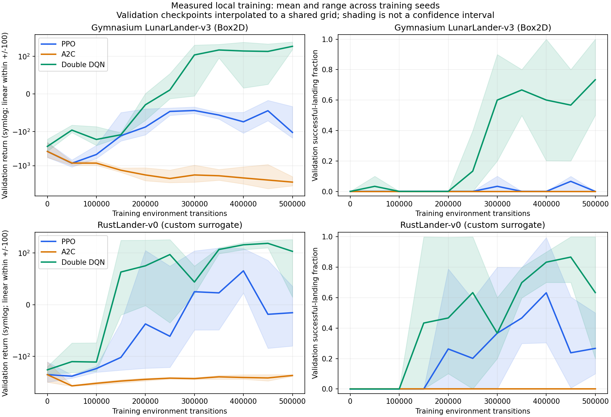

# lunar_bench: PPO vs A2C vs Double DQN on LunarLander, from scratch in NumPy

PPO, A2C and Double DQN written from scratch in NumPy are trained under one fixed budget (500k environment steps,
3 training seeds, 100 held-out test episodes per seed, CPU only). Training runs on Gymnasium **LunarLander-v3
(Box2D)** and on **RustLander-v0**, a simplified landing simulator written in Rust with a batched C ABI.

| Double DQN: lands (+229, 302 steps) | PPO: hovers until the time limit (−44) | A2C: crashes (−3,946) |
|---|---|---|
|  |  |  |

*Same held-out test episode (environment seed 2000000000) and seed-0 checkpoints, greedy actions. Each GIF is a
replay that was checked to match the recorded test episode step for step.*

## Results at a glance: Gymnasium LunarLander-v3 (greedy policy, final 500k-step checkpoint)

| method | mean test return ± SD over 3 seeds | per-seed range | successful landings | training time per seed |
|---|---|---|---|---|
| **Double DQN** | **184 ± 67** | 122 to 255 | **70 %** (52–96 %) | 201 s |
| PPO | −105 ± 72 | −152 to −23 | 0 % | 61 s |
| A2C | −2,666 ± 1,115 | −3,908 to −1,750 | 0 % | 53 s |
| hand-written heuristic controller | 235 | – | 92 % | – |
| random actions | −190 | – | 0 % | – |

Secondary evaluation of the same actor-critic checkpoints, with actions **sampled** from the policy instead of the
argmax:
* PPO scores 24 ± 140 with 43 % landings (seed 0: 174 and 80 %).
* A2C scores −45 with 0 % landings.



### Key findings
* **Double DQN is the only method that learns to land on the Box2D task within 500k steps**: 70 % landings on
  average, ranging from 52 % to 96 % across the three seeds.
* **PPO's greedy policy never lands, but sampling from the same policy does** (43 % on average). Under argmax
  execution the lander hovers until the 1,000-step limit, so the policy has learned useful behaviour that only
  shows when its actions are sampled. Both evaluation modes are reported, kept separate.
* **A2C diverges with these settings**: its validation return keeps falling during training. This is a result
  for one configuration, not a verdict on A2C, because no hyperparameters were tuned.
* **The batched Rust simulator delivers about 100× more transitions per second** than stepping Box2D from Python.
  RustLander is a simplified point-body model, though, so its scores and speed are not comparable to LunarLander
  ([RUST_MODEL.txt](RUST_MODEL.txt)).
* **Limitations:**
  * Only 3 training seeds, so the "range" column is the full spread, not a confidence interval.
  * One fixed hyperparameter setting per method.
  * CPU only, on one Windows laptop.

## RustLander-v0 (simplified simulator, same protocol)

| method | mean test return ± SD | successful landings |
|---|---|---|
| Double DQN | 105 ± 61 | 63 % |
| PPO | −28 ± 52 (sampled: 49) | 21 % (sampled: 47 %) |
| A2C | −264 ± 7 | 0 % |
| heuristic / random | 191 / −153 | 100 % / 0 % |

## Simulator throughput (isolated runs after training, steps per second)

| mode | steps/s | notes |
|---|---|---|
| Gymnasium Box2D, one env stepped from Python | 6,455 ± 1,415 | 5 repeats × 100k steps |
| RustLander, one env stepped from Python (FFI per step) | 8,722 ± 1,720 | 5 repeats |
| RustLander, batch of 128 envs per FFI call | 691,408 ± 172,879 | 5 repeats |
| RustLander, pure Rust loop (no FFI) | ≈ 16.9 M | 3 repeats, separate run |

Running six independent single-thread training processes in parallel was **4.7× faster** than running them one
after another (153 s → 32 s for 6 runs of 32,768 steps; a single matched timing pair).

## Protocol
* **Environment:** unmodified Gymnasium 1.2.3 LunarLander-v3 with Box2D 2.3.10, discrete actions, default
  gravity, no wind and a 1,000-step time limit.
* **Agents:**
  * PPO and A2C use one 64-unit tanh layer.
  * Double DQN uses two 64-unit ReLU layers.
  * Actor-critic optimisation scales rewards by 0.01; reported returns are always the unscaled environment rewards.
* **Budget and seeds:** 500,000 transitions per method, environment and training seed (seeds 0, 1, 2).
  Training, validation and test use separate, independent seed ranges.
* **Evaluation:**
  * The final fixed-budget checkpoint is reported, not the best test score.
  * The primary evaluation is greedy, over 100 test episodes per checkpoint. The stochastic evaluation is a
    separate, secondary result.
  * A landing counts as successful when the episode terminates on the pad with the +100 terminal reward.
* **Parallelism:** six independent subprocesses with one BLAS thread each. Rust training makes one native call per
  batch of eight environments. Timing during training includes contention, which is why throughput was measured
  separately afterwards.
* **Scope:** this is a first controlled comparison, not a hyperparameter sweep or a claim about any algorithm's
  best possible performance.

## Reproduce
The repository is a Python package, so clone it into a folder named `lunar_bench` and run from that folder's parent.

```bash
git clone https://github.com/ryanlai666/lunar_bench.git lunar_bench
pip install -r lunar_bench/requirements.txt          # or: pip install --target lunar_bench/deps ... (added to sys.path)
cargo build --release --manifest-path lunar_bench/native/Cargo.toml   # RustLander (Rust toolchain needed)

python -m unittest lunar_bench.test_agents lunar_bench.test_rust_env -v
python -m lunar_bench.launch --steps 500000 --jobs 6 --output lunar_bench/results/new_benchmark
python -m lunar_bench.report lunar_bench/results/new_benchmark
```

Post-processing used for the published results:
```bash
python -m lunar_bench.audit_results lunar_bench/results/benchmark_500k
python -m lunar_bench.evaluate_stochastic lunar_bench/results/benchmark_500k --jobs 3 --episodes 100
python -m lunar_bench.throughput --steps 100000 --repeats 5 --output lunar_bench/results/throughput_isolated.json
python -m lunar_bench.parallel_timing
python -m lunar_bench.render_rollouts
```
Use a new output directory for every run, because existing runs are never overwritten. Tested on Windows 11 with
Python 3.13; `build_native.ps1` is the Windows build script. Model checkpoints (`final.npz`) are not included in
the repository. Every run's configuration, learning logs, 100 raw test episodes and timing are included.

## Layout
```
agents.py, baselines.py      NumPy PPO / A2C / Double DQN, random and heuristic baselines
run.py, launch.py            one training run; parallel launcher
rust_env.py, native/         RustLander-v0 (Rust crate, C ABI) and its Python wrapper
throughput.py, benchmark_native.py, parallel_timing.py   timing benchmarks
evaluate_stochastic.py, audit_results.py, render_rollouts.py, report.py   evaluation, audit, GIFs, HTML report
results/benchmark_500k/      18 runs (3 methods × 2 environments × 3 seeds), summary CSV, audit,
                             learning curves, HTML report (download to view), GIF previews
results/baselines/           random and heuristic controllers
```

## Sources
* Gymnasium LunarLander: https://gymnasium.farama.org/environments/box2d/lunar_lander/
* PPO: https://arxiv.org/abs/1707.06347
* Double DQN: https://arxiv.org/abs/1509.06461
* A2C background: https://stable-baselines3.readthedocs.io/en/master/modules/a2c.html

These are small custom NumPy agents, not Stable-Baselines3 runs, and no published scores are used in the comparison.
